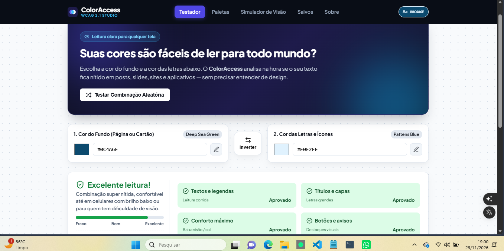
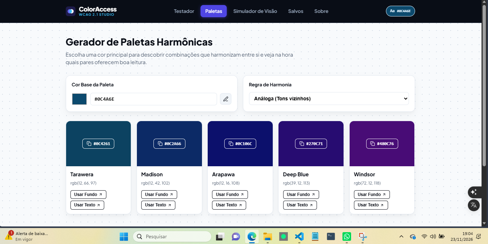
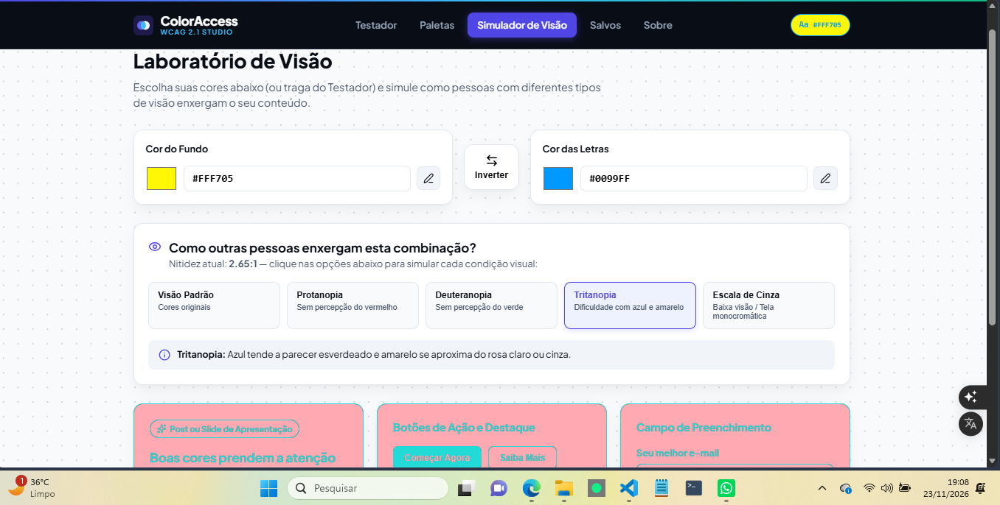
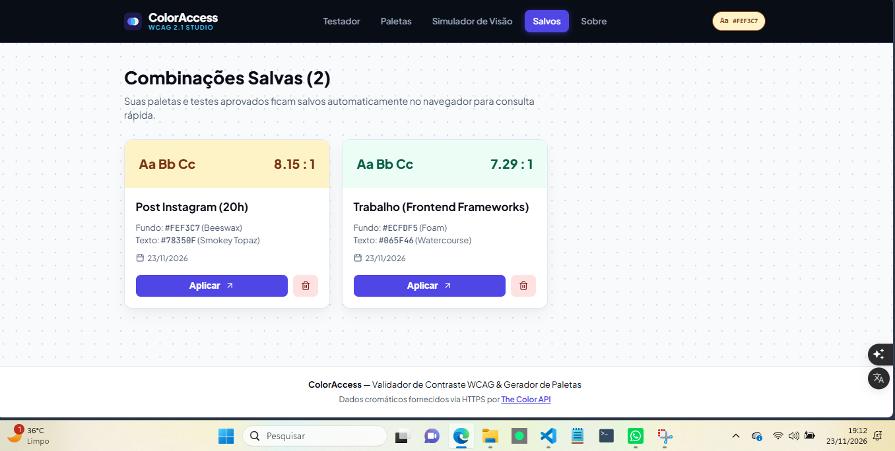

# ColorAccess — Estúdio de Contraste & Acessibilidade Visual

Aplicação web desenvolvida em **React + TypeScript + Vite** como projeto final da disciplina de **Framework Front-End** (ADS — Uninassau).
O objetivo é ajudar qualquer pessoa a testar se a combinação entre cor de fundo e cor das letras oferece boa leitura, gerar paletas harmônicas e simular diferentes tipos de visão.
---
## Membro e Componentes Desenvolvidos

* **Desenvolvedor:** Luiz Cláudio Brito Rocha de Sousa
* **O que foi desenvolvido:**
  * **Roteamento (`src/App.tsx`):** Navegação entre as 5 páginas da aplicação usando `react-router-dom`.
  * **Estado Global (`src/context/ColorContext.tsx`):** Compartilhamento das cores entre todas as telas (`useContext`) e salvamento no navegador (`localStorage`).
  * **Conexão com API Pública (`src/services/colorApi.ts`):** Consulta à *The Color API* para identificar nomes de cores e gerar paletas harmônicas.
  * **Cálculo de Contraste (`src/utils/contrast.ts`):** Cálculo WCAG 2.1 (AA e AAA) e função que corrige automaticamente letras difíceis de ler.
  * **Componentes (`src/components/`):** `Navbar`, `Footer`, `ColorPickerInput`, `ContrastBadge`, `ColorSwatchCard`, `LiveUIPreview` e `EmptyState`.
  * **Páginas (`src/pages/`):** `HomeChecker` (Testador), `PaletteGenerator` (Paletas), `UiLab` (Simulador de Visão), `SavedThemes` (Salvos) e `AboutProject` (Sobre).
---

## Funcionalidades Principais
- **Testador de Contraste em Tempo Real:** Avaliação imediata de nitidez baseada nas diretrizes WCAG 2.1 (níveis AA e AAA), com barra visual intuitiva e botão de correção automática de leitura.
- **Gerador de Paletas Harmônicas:** Integração com a **The Color API** para descoberta de nomes oficiais de cores e geração de esquemas (Análogo, Complementar, Tríade e Monocromático).
- **Simulador de Visão:** Filtros ópticos SVG (`feColorMatrix`) para testar a leitura em **Protanopia**, **Deuteranopia**, **Tritanopia** e **Escala de Cinza**.
- **Combinações Salvas:** Persistência local via `localStorage` para guardar, reaplicar ou remover paletas favoritas.

## Como Instalar e Rodar no Computador

1. Baixe ou clone este repositório.
2. Abra a pasta `coloraccess` no terminal e instale as dependências:
   ```bash
   npm install

## Tecnologias e Hooks Utilizados
- **React 18 + TypeScript + Vite**
- **React Router DOM** (navegação SPA entre 5 páginas)
- **Lucide React** (iconografia)
- **Hooks:** `useState`, `useEffect`, `useContext`, `useMemo` e `useNavigate`

## Prints das Telas Principais

### 1. Testador de Contraste


### 2. Gerador de Paletas


### 3. Simulador de Visão


### 4. Combinações Salvas
